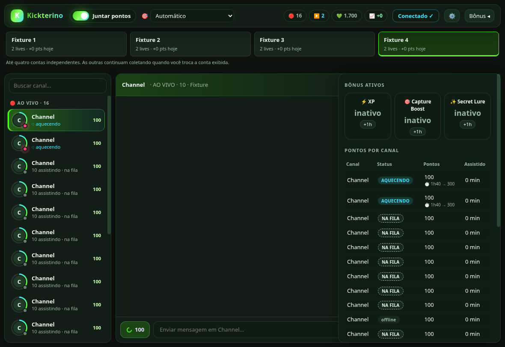

# Kickterino

Cliente de chat para a Kick no estilo do [Chatterino](https://chatterino.com/), feito para a comunidade do PokeIdle. Ele mantém 2 lives em segundo plano, com o mínimo de memória e internet, para acumular pontos do canal e comprar bônus.

Fork independente de manutenção de [ViinniSantoos/kickterino](https://github.com/ViinniSantoos/kickterino), criado por VinniiSaantos. Licença e histórico MIT preservados.

Distribuição deste fork: [Releases de jggomes11/kickterino](https://github.com/jggomes11/kickterino/releases). Esta alteração ainda precisa da validação real no Windows antes da publicação estável.



## Recursos

- **Lista lateral de canais com busca**, favoritos e grupos ao vivo/offline, com chat ao centro, envio de mensagens e aviso de resgates.
- **Disposição como no Twitchterino:** cabeçalho compacto, quatro contas, configurações na engrenagem e painel de bônus à direita.
- **Painel de pontos** com saldo, status e ganho de cada canal.
- **Foco em bônus:** as vagas vão para os canais mais perto de 300 pontos, depois 500, 1.000 e cada milhar seguinte.
- **Modo leve:** lives ocultas em 160p, sem som, sem imagens e sem anúncios.
- **Modo 24/7:** fica na bandeja, inicia com o Windows e se recupera de quedas e de suspensão.
- **Avisos de bônus** quando um canal alcança 300, 500 ou 1.000 pontos.
- **Até quatro contas opcionais numa janela**, com cookies, canais, preferências, players e relatórios independentes. Trocar a conta exibida mantém as demais coletando.
- **Atualizações manuais**: verificações, downloads e instalação automáticos estão desativados.

## Como funciona

O app é feito em Electron e não tem servidor próprio.

- Cada live é a página real da Kick, aberta numa janela invisível e sem som.
- O processo principal consulta status e saldo pela sessão persistente de cada conta; tokens não são injetados em páginas. A janela oficial é usada para login.
- O protocolo DevTools limita a live à menor qualidade e lê o chat da conexão em tempo real que a página da Kick já abre.
- A cada minuto, o app confere o estado dos canais e reorganiza as vagas.

## Medições anteriores do projeto original

Estas medições históricas não garantem o limite atual da Kick nem validam a integração deste fork.

- A Kick conta cerca de 2 lives por vez por conta. Com 2, 3, 4 ou 10 lives abertas, o ganho total foi o mesmo.
- O limite vale entre aparelhos: celular e TV disputam as mesmas 2 vagas com o app.
- A primeira contagem leva cerca de 6–7 min depois que a live abre. Depois, são +10 a cada ~5–6 min, ou cerca de 220 pontos por hora.
- O painel tem um **teste de limite**, que refaz essa medição na sua conta.

## Segurança da conta

- O login é feito na própria página da Kick, Google, Apple ou Discord. O app não lê nem guarda a senha.
- Não há servidor do Kickterino: a sessão fica só no seu PC, com os cookies criptografados pelo Windows.
- Só a Kick e as páginas de login abrem dentro do app. Outros sites são bloqueados, e nenhuma página acessa câmera, microfone ou localização.
- **Sair da conta** apaga do app todos os dados de login, mantendo a lista de canais e as preferências.
- Baixe só do site ou dos Releases deste repositório, e nunca envie a pasta de dados do app para ninguém.

## Contas e instalação

Use **Kickterino-Setup.exe**, o instalador Windows deste fork. Uma ou duas contas são suficientes; os quatro slots são opcionais. Faça login pela página oficial em cada slot utilizado. A bandeja e a inicialização com o sistema pertencem ao app; coleta, lojas e configurações pertencem à conta selecionada. Sair da conta limpa somente aquele slot. **Sair** na bandeja encerra o aplicativo inteiro.

A primeira conta mantém o perfil instalado existente (`persist:kick` e `config.json`); as outras usam perfis separados. Atualizações pelo instalador preservam esse perfil. Perfis de versões portáteis ou outros navegadores não são importados automaticamente. Feche pelo comando **Sair** antes de atualizar.

Consultas usam destinos e rotas fixos, recusam redirecionamentos e limitam tempo e tamanho. IPC valida origem e argumentos. Mudanças verificadas de identidade separam relatórios; renovar sessão da mesma conta conserva a referência do saldo. Esses controles não certificam o aplicativo ou os serviços externos como livres de vulnerabilidades.

## Desenvolvimento

Requer Node.js >=22.13; validação com Node.js 24 e Electron 45.2.1.

```bash
npm ci
npm test
npm run test:electron
npm run test:accounts
npm start
```

Os testes usam credenciais fictícias e perfis temporários. `test:accounts` precisa de desktop gráfico (Windows ou display X11 no Linux). Flags sem sandbox ficam restritas aos fixtures Linux.

Para gerar somente o instalador Windows em `dist/`, sem publicar:

```bash
npm run dist -- --publish never
```

## Validação real antes da publicação

Os fixtures comprovam transporte, quatro sessões fictícias, seleção, players e persistência; não comprovam login ou ganho de pontos em contas reais. No Windows, testar com duas contas reais: entrar pela página oficial em cada slot, manter canais/configurações distintos, confirmar os saldos subindo nas duas enquanto alterna, enviar chat com a identidade correta, sair de apenas uma conta e reiniciar para verificar persistência. Quatro contas reais permanecem não verificadas quando só duas são usadas.

A integração usa endpoints internos da Kick; um bloqueio ou mudança de formato deve aparecer como sessão indisponível, sem voltar a injetar tokens na página.

## Limitações

- A distribuição de destino é Windows; o pacote Linux é usado também para verificação local.
- O saldo e o envio de mensagens usam endpoints internos da Kick, que podem mudar sem aviso.
- O chat só aparece nos canais que estão sendo assistidos.
- O app ainda não tem assinatura digital, então o Windows pode exibir um aviso na instalação.
- Projeto independente, sem ligação com a Kick ou o PokeIdle. Assistir sem estar presente pode ir contra os termos de uso da Kick; use por sua conta e risco.

## Licença

[MIT](LICENSE)
